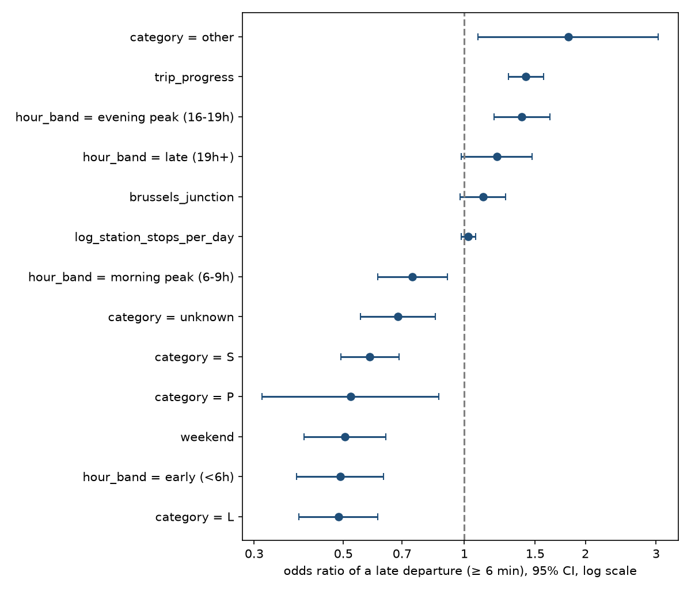

# RailPulse Delays — what really explains a late SNCB departure?

The RailPulse dashboards *describe* delays ("Bruxelles-Central: 53% on time").
This study asks the statistical question behind them: **which factors known in
advance raise the risk that a departure leaves 6 minutes late or more, by how
much, and can that risk be predicted?**

Data: SNCB GTFS-Realtime liveboards polled every 15 minutes by the
[RailPulse Azure pipeline](https://github.com/Siegried81/railpulse-challenge-azure),
27 July – 7 August 2026, exported to `railpulse-genai/data/`.

## The unit of analysis, measured

| | |
|---|---|
| Raw rows | 980,868 polling snapshots (9.9 per stop on average) |
| Stop events (one train, one station, one day) | **99,014** |
| Analysed (rail-replacement buses removed) | 97,146 stops, 11,662 train runs, 598 stations |
| Late (≥ 6 min, the Infrabel punctuality threshold) | 7.6% |

Two traps decide every number downstream, and both are tested in
`tests/test_prepare.py`:

- **A row is a snapshot, not a departure.** The same stop is captured on every
  poll until the train leaves; aggregating raw rows weights a stop by how often
  it was polled. The latest snapshot per stop event is kept.
- **`scheduled_time` is not the timetable time.** It moves with the delay
  (08:05 at 0 s, 08:06 at 60 s). The planned time is rebuilt as
  `scheduled_time − delay_seconds` (stable in 99.9% of stops) and every time
  feature is cut on it.

## Method

- **Logistic regression with standard errors clustered by train run.** Stops of
  one train are correlated (a late train stays late), so treating 97k stops as
  independent understates every interval: clustered standard errors are
  **2.6× wider** than the naive ones (median over terms).
- **Two sensitivity analyses:** a fixed effect per day (absorbs weather and
  incidents), and only stops whose delay was observed after departure.
- **Temporal hold-out:** fit on 27 Jul – 3 Aug, score on 4 – 7 Aug.
- **Gradient boosting on the same variables** as a yardstick for the readable
  model.

## Results

Odds ratios against a daytime intercity stop on a weekday, outside Brussels
(`results/odds_ratios_planning.csv`):

| Factor | Odds ratio | 95% CI |
|---|---|---|
| Evening peak (16–19h) | **1.39** | 1.19 – 1.63 |
| Morning peak (6–9h) | 0.74 | 0.61 – 0.91 |
| Local train (L) vs IC | 0.49 | 0.39 – 0.61 |
| International / other | 1.81 | 1.08 – 3.04 |
| Position along the trip (start → end) | **1.42** | 1.29 – 1.57 |
| Brussels North–South junction | 1.11 | 0.98 – 1.27 |
| Station size (per e-fold of daily stops) | 1.02 | 0.98 – 1.07 |



- **The Brussels junction's excess is confounding.** Raw: 10.1% late against
  7.4% elsewhere. Controlled for hour and train type, the effect is not
  distinguishable from zero.
- **Delay accumulates along the trip**, and the evening peak is the riskiest
  window. The morning peak is *less* risky than daytime: summer holidays,
  so this is not expected to hold in term time.
- **Explaining is not predicting.** Out of sample (`results/holdout_scores.csv`):

| Model | AUC | Brier |
|---|---|---|
| Base rate | 0.500 | 0.0640 |
| Logistic, timetable variables | 0.591 | 0.0640 |
| Gradient boosting, same variables | 0.618 | 0.0635 |
| Logistic + delay at the previous stop | **0.924** | **0.0235** |

The timetable shifts the risk by a few points but cannot single out a late
train; the delay at the previous stop can (each minute doubles the odds, OR
2.01). The planning model over-predicts on the test days (6.9% late against
8.1% in training): it would need re-fitting as conditions drift.

## Limits

Twelve summer days, one weekend; no incident, weather or connection data; trip
position is measured over the 598 polled stations only; 13% of stops have no
train category in the static GTFS; correlation, not causation.

## Run it

```bash
python -m venv .venv && .venv/bin/pip install -r requirements.txt
.venv/bin/python -m pytest -q          # 14 tests
.venv/bin/python run_analysis.py [DATA_DIR]   # default ../railpulse-genai/data
```

`src/prepare.py` builds stop events and features, `src/model.py` fits and
scores the models, `run_analysis.py` writes `results/` and `figures/`.
